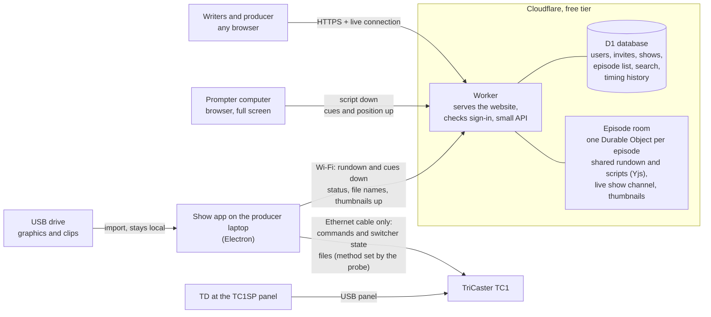

# TSTV Show Automation — Architecture

Oct 28, 2026 · Proposed by Claude Code for RG · **Status: waiting for RG's OK**

This document covers what the website, the prompter and the show app are built with, and how they talk to each other. It follows [PROJECT_BRIEF.md](PROJECT_BRIEF.md), which stays the source of truth. One recommendation differs from the brief's suggested default (Cloudflare instead of Supabase). Section 2 explains it, and it needs your OK.

## 1. The short version

| Part | Built with | Runs where | Cost |
| --- | --- | --- | --- |
| Website (rundowns, scripts, sign-in) | A React web app plus a Cloudflare Worker | Cloudflare's free tier, at a free `….workers.dev` address | $0 |
| Live co-editing | Yjs (the shared-editing library the brief names), synced through one "episode room" per episode | Cloudflare Durable Objects | $0 |
| Prompter | A full-screen page of the same website | A browser on the existing prompter computer | $0 |
| Show app | Electron desktop app | Producer laptops, Mac and Windows | $0 (unsigned installers on GitHub) |
| Link to the TC1 | The TriCaster's own built-in network control, the same one Bitfocus Companion uses | The one Ethernet cable | $0 |
| Probe and simulator | Small Node.js programs | Any laptop | $0 |
| Sign-in | "Sign in with Google" plus an invite list the TD controls | Google and Cloudflare | $0 |

Everything is written in **TypeScript**, which is JavaScript with extra checks that catch mistakes before the code runs. With one language for everything, the website, prompter and show app can share code (the cue rules and the graphics file-name parser), and one person can maintain all of it.

## 2. The one change from the brief: Cloudflare instead of Supabase

The brief suggests "a static site on a free host plus Supabase's free tier." I checked both services' current free tiers and recommend putting everything on Cloudflare instead. Here's why, in plain terms:

1. **Supabase's free projects go to sleep, and a long sleep can't be undone.** A free Supabase project pauses after 1 week with no activity. You can wake it from the dashboard, but only within 90 days of the pause. After that it can't be restored, and you can only download a backup and rebuild. Summer break is about 90 days. Cloudflare doesn't pause free projects, so the site works on the first day of fall without anyone remembering to wake it.
2. **Co-editing and cues send many small messages.** Supabase's free tier includes 2 million live messages a month for everything. Each keystroke in a shared script goes to everyone viewing it, and the prompter reports its position several times a second, so that allowance could run short. Cloudflare counts every 20 incoming live messages as one request and allows 100,000 requests a day, which works out to roughly 2 million live messages a day. Section 10 has the busy-day estimate.
3. **Yjs already runs on Cloudflare.** `y-partyserver` is maintained in Cloudflare's own `partykit` repository. It runs a Yjs document inside a Durable Object and supports hibernation, so a browser tab left open overnight costs nothing. Supabase has no official Yjs support.
4. **One account, one dashboard and one deploy command** are easier for the next TD to take over.

**The trade-off.** Supabase comes with a ready-made sign-in system and a spreadsheet-style database editor. On Cloudflare I'll build sign-in around "Sign in with Google" (section 4.4), which is a small, well-known piece of work. Cloudflare's database console is plainer.

If you'd rather stay with Supabase, most of this document still holds. The main differences would be where the data lives, plus a scheduled job that keeps the project from pausing.

**If you approve**, I'll update the "Free hosting only" bullet in `docs/PROJECT_BRIEF.md` in the same commit, following the project rules.

## 3. How the parts talk to each other

Every connection to the cloud goes through the Worker, which checks sign-in before passing it to an episode room.

| Link | What travels | How | If it drops |
| --- | --- | --- | --- |
| Writers' browsers ↔ episode room | Rundown and script edits, everyone's cursors | WebSocket (a connection that stays open both ways) carrying Yjs updates | Typing keeps working, and edits merge when the connection returns |
| Prompter ↔ episode room | Script down. Cue crossings, section starts and position (about 4 times a second) up | Same kind of WebSocket | The prompter keeps scrolling the last script and shows a small warning. The show app shows a "lost prompter" banner, and the producer fires cues with the spacebar |
| Show app ↔ episode room | Rundown, scripts and prompter events down. App status, element Ready/Missing, file names, lengths and thumbnails up | WebSocket over Wi-Fi | Same banner. TC1 control and Pause keep working because they never use the internet |
| Show app ↔ TC1 | Commands (take a camera, DSK 2, DDR2 play and stop, record) and switcher state | The cable only. The TriCaster's network control on ports 80 and 5951 (section 7), to be confirmed by the probe | "TC1 disconnected" banner. The TD takes over on the panel |
| Show app → TC1 files | Graphics and clips | Windows file sharing over the cable, **if the probe shows the TC1 allows it**. Otherwise the TD loads from USB as today | — |

**Media never goes to Cloudflare.** Only file names, lengths and small thumbnails do.

## 4. Website

### 4.1 Building blocks

| Piece | Choice | Why |
| --- | --- | --- |
| Pages and buttons | React, Vite and TypeScript | The most common way to build web apps today, with plenty of help available |
| Server code | A Cloudflare Worker using Hono, a small web framework | Runs on the free tier and also serves the website's files |
| Database | Cloudflare D1 (SQLite) | Free. Holds users, invites, shows, the episode list, the search index and timing history |
| Live co-editing | Yjs plus `y-partyserver`, with one Durable Object per episode (the "episode room") | Several people type in the same rundown and script at once, with no overwritten work and everyone's cursors visible |
| Script editor | TipTap, built on ProseMirror, with its open-source Yjs collaboration and cursor add-ons | Rich text where cue chips are locked items that can't be typed over |
| Dragging rundown rows | dnd-kit | Reorders rows and floats sections |
| PDF and CSV export | Generated in the browser | Costs nothing on the server |

### 4.2 What lives where

- **Episode room (one per episode).** The rundown rows (blocks, sections, slug, segment type, talent, camera, green-screen background name, floated flag, elements), every section's script with its cue chips, and the live show channel. Because the prompter, the producer and every writer share one live copy, an edit appears everywhere within about a second. The room saves itself every few seconds. It also holds the episode's thumbnails: small JPEGs of about 15 KB each.
- **D1 database.** Users and invites. Shows and their settings: default camera, camera names, usual talent, target length, words per minute and the segment-type list. The episode list, searchable text of archived episodes, and timing history.
- **Never in the cloud:** media files.

### 4.3 Timing

The browser works out timing from the shared rundown: script words ÷ words per minute, plus clip lengths from the show app's import. Back-times and over/under come from the show's target length. During a show, the episode room records each section's actual start and length from the prompter's events and saves them to D1 at the end.

### 4.4 Sign-in

- **"Sign in with Google"** works with any Google account, personal Gmail included. We store no passwords, there's nothing to reset, and no email service is needed.
- **Only people on the invite list get in.** The TD (admin) adds email addresses on an admin page. Anyone else sees "Ask the TD for an invite."
- The open question "invited people only, or anyone with a UT email?" becomes a setting: the invite list can also allow a whole email domain later.
- **The prompter computer and each show-app laptop sign in once as a device.** The device shows a pairing code, and a signed-in person approves it. The device stays signed in until the TD removes it.
- **Why not our own passwords:** Cloudflare's free tier allows 10 ms of computing per request, which is too little to store passwords safely. Google handles that part for us.

### 4.5 Archive and export

Archiving makes the episode room read-only and copies the scripts' text into D1 so they stay searchable. Export builds the rundown PDF and CSV in the browser.

## 5. Prompter

- **What it is:** a page of the website (`/prompter/<episode>`), opened full-screen in Chrome or another modern browser on the existing prompter computer. Nothing is installed.
- **Content:** it reads from the same episode room as the editors, so script edits appear within about a second. Each section starts with its number and talent name, color-coded by talent, and cue chips show as bold colored markers. Floated sections are skipped.
- **Scrolling:** smooth scrolling runs in the browser at 60 frames a second. The arrow keys change speed and the spacebar pauses, exactly like today. Other keys jump between sections. The settings from the brief (text size, margins, colors, reading-line position) are saved on that computer.
- **Keeping its place during edits:** the prompter tracks which word sits on the reading line. When text above it changes height, it shifts the scroll by exactly that amount, so the line the anchor is reading doesn't move.
- **Cue firing:** every cue chip and section start has a permanent ID. When one crosses the reading line, the prompter sends the ID and the time to the episode room. It also sends its position about 4 times a second.
- **Internet drops:** the prompter keeps a copy of the script in the browser (it even survives a page reload), keeps scrolling and shows the runner a small warning. It doesn't replay missed cues when the connection returns, because a late graphic is worse than none. Instead, the show app's banner prompts the producer to fire cues by hand.

## 6. Show app

### 6.1 Why Electron

Electron is what apps like Slack and VS Code are built with. One codebase produces both a Mac app and a Windows app. It includes Node.js, which can do the three things the brief says a browser can't: send commands to a device on a local cable, keep an open connection for clip status, and copy files onto the TC1. It can also reuse the website's code.

### 6.2 Inside the app

| Part | Job |
| --- | --- |
| Switcher driver | The only code that talks to a switcher. It comes in two versions, Simulator and Live TC1 |
| Cue engine | Applies the brief's cue rules table. It's pure logic with no network code, so every rule can have automatic tests |
| Website link | The WebSocket to the episode room. It receives the rundown, scripts and prompter events |
| Importer | Reads names like `B5_VO_Basketball.mov`, matches each file to its cue, and stops to ask when unsure. It uses FFmpeg (free, bundled with the app) to read clip lengths and make thumbnails, including from ProRes 4444 |
| Sender | Copies files to the TC1 and builds the DDR2 playlist (Phase 5). The method depends on the probe results |
| Producer screen | Camera buttons, On air / Up next, preview, Pause, Record, show clock, status lights and cue latency |

### 6.3 Live mode: three safety locks

1. **The app always opens in simulator mode.** It never remembers live mode between launches.
2. **Turning on live mode takes a deliberate step**: a switch plus a confirmation. After that, a red "LIVE: TC1" bar stays across the top of the window.
3. **The driver checks what it's talking to.** In simulator mode it refuses to send anything to a device that doesn't identify itself as the TSTV simulator. Typing the TC1's address by mistake still sends nothing.

**Pause** is one switch inside the driver. While it's on, the driver sends nothing to the switcher. Pause, Resume and every TC1 command travel only over the cable.

### 6.4 Reaching the TC1 with no settings changes

When two computers are joined by a single cable with no router, each one gives itself an automatic "self-assigned" address (169.254.x.x), and then they can talk. Windows does this when a port is set to get its address automatically, which is the default, and Macs do the same. The app looks for the TC1 only on the wired adapter. The probe will confirm three things:

- the TC1's port is set to automatic, not a fixed address;
- Windows Firewall on the TC1 lets the connection through;
- a Mac sends the traffic over the cable rather than Wi-Fi. This is a known quirk when both connections are on, and the app handles it by sending from the cable's own address.

### 6.5 Installing and updating

- GitHub Actions, which is free for public repositories, builds the Mac and Windows installers automatically. They're published as a `.dmg` and an `.exe` on the repo's Releases page.
- **No paid code signing.** The Mac build gets a free "ad-hoc" signature so it runs on Apple-silicon Macs. On first open, macOS needs **System Settings → Privacy & Security → Open Anyway**, and Windows needs **More info → Run anyway**. The producer guide in Phase 6 will show both with screenshots.
- **Updates:** the app checks the Releases page and shows "New version available" with a download link. Fully automatic updates on a Mac require paid signing.

## 7. Talking to the TC1

I read [bitfocus/node-tricaster](https://github.com/bitfocus/node-tricaster) and the Bitfocus Companion TriCaster module, [bitfocus/companion-module-newtek-tricaster](https://github.com/bitfocus/companion-module-newtek-tricaster). Together they use three interfaces:

| Interface | Port | What it does |
| --- | --- | --- |
| HTTP API (`/v1/…`) | 80 | **Read:** `/v1/version`, `/v1/dictionary?key=tally`, `…?key=switcher`, `…?key=shortcut_states` and `…?key=macros_list`. **Command:** `/v1/shortcut?name=…&value=…` |
| Change notifications | 80 (WebSocket at `/v1/change_notifications`) | The TriCaster announces which part of its state just changed |
| State stream | TCP 5951 | A tool sends `<register name="NTK_states"/>`, and the TriCaster then streams every state value as XML. This port also accepts commands |

Command names Companion uses include `main_a_row` and `main_b_row` (program and preview source), `main_dsk2_auto`, `ddr1_play`, `record_toggle` and `play_macro_byname`. Bitfocus tested on a TC2 Elite and a TC Mini 4K, not a TC1 on version 7, so **the probe confirms the exact names and formats on our unit.** Companion also asks users to turn off the LivePanel password. The probe will report whether ours is on. If it is, you can type it in when the probe asks, and the probe won't save it.

If a direct command turns out not to exist, the fallback from the brief still applies: the TD builds a TriCaster macro once, and the app triggers it with `play_macro_byname`.

### 7.1 The probe (Phase 0)

- **One command:** `npm run probe`. It needs only Node.js, which you already have. It uses no extra packages.
- **What it does:**
  1. Lists the laptop's network adapters.
  2. Finds the TC1 on the cable, using the automatic addresses, the TC1's network announcements and a quick port check.
  3. Reads `/v1/version` and the known dictionary keys.
  4. Listens to the change notifications and the port 5951 stream for about a minute while you press a few panel buttons yourself, outside a show, so we can see what each change looks like.
  5. Checks whether file sharing (port 445) is open.
  6. Saves `tstv-probe-results-<date>.json` and prints a short summary you can read.
- **Read-only by design:** the probe contains no code that can send a command. Its only web requests are reads from a fixed list of addresses, never `/v1/shortcut`. On port 5951, the only thing it sends is the "send me updates" message. An automatic test fails if command text ever appears in the probe's code.

## 8. Simulator

- **What it is:** a small Node program that pretends to be the TC1 on your own laptop. It answers at the same HTTP addresses, on the same WebSocket and the same port-5951 stream, and accepts the same command names. Because the show app's real TC1 code is what gets tested against it, only the address changes when we go live.
- **What you see:** a web page that works like a mini multiviewer. It shows program and preview, DSK 2 on or off, the DDR2 playlist and playhead (clips "play" for their real lengths), GFX 1, M/E 2 and recording.
- **How it stays accurate:** it starts from what Bitfocus documents, then gets corrected from your probe results so it matches our TC1.
- **How it's told apart:** it identifies itself as "TSTV Simulator", which is how the live-mode lock in section 6.3 tells it apart from the real switcher.
- **Practice problems:** it can fake trouble on demand, such as the TC1 unplugged, slow replies or a clip ending early.

## 9. Cue path and latency

A cue travels prompter → episode room → show app → TC1. Expected time for each hop:

| Hop | Expected |
| --- | --- |
| Prompter → Cloudflare, over campus Wi-Fi | 20–60 ms |
| Cloudflare → show app, over Wi-Fi | 20–60 ms |
| Show app → TC1, over the cable | under 20 ms |
| **Total** | **about 50–150 ms**, against the brief's 500 ms target |

Cloudflare places each episode room near whoever opens it first, which for us will most likely be a Texas data center. To measure the latency, the room sends each device a quick timing ping so their clocks can be lined up. The app then shows the time from reading line to TriCaster command for every cue: green under 0.3 s, amber up to 0.5 s and red above.

## 10. Free-tier check

Checked Oct 28, 2026. Limits change, so I'll recheck before each deploy phase.

| Service | Free limit today | Our busy-day estimate | If we ever hit it |
| --- | --- | --- | --- |
| **Cloudflare Workers** | 100,000 requests a day; 10 ms of computing per request; requests for the website's files are free and unlimited | Under 10,000 requests | That kind of request fails until the daily reset |
| **Durable Objects** (episode rooms) | 100,000 requests a day, where 20 incoming live messages count as 1 request; 13,000 GB-seconds of awake time a day (about 29 room-hours); 5 GB storage in total; 100,000 rows written a day | About 15,000 requests (10 writers typing for 2 hours, plus one show); 5–10 room-hours, since idle tabs hibernate; under 1 MB per episode; a few thousand rows a day, because saves are batched | Same |
| **D1 database** | 5 million rows read and 100,000 written a day; 500 MB per database; 5 GB in total; 10 databases | Well under 1% | Same |
| **GitHub** | Public repository. Actions are free for public repositories on standard runners. Each Releases file must be under 2 GiB, with no bandwidth limit | Installers of about 100–200 MB | — |
| **Google sign-in** | Free. Apps that ask only for name and email (non-sensitive scopes) don't need Google's verification | About 50 people | — |

- **Daily reset.** Cloudflare's daily limits reset at 00:00 UTC, which is 7 pm Central during daylight saving time and 6 pm in winter. Even if a limit ran out mid-show, TC1 control and Pause would keep working, and the producer could fire cues with the spacebar.
- **Sleep and wake.** Cloudflare doesn't pause free projects, so there's nothing to wake after winter or summer break. The brief asks for wake-up instructions, and with this stack there are none to give.
- **Usage page.** I plan an admin page that shows today's usage against these limits, as part of Phase 1.
- **What we avoid on purpose:**
  - Cloudflare R2 file storage, which asks for a payment method even on its free tier
  - Any paid plan
  - Apple and Microsoft code signing
  - A custom domain, which costs money; the free `….workers.dev` address works fine
- **No credit card.** New Cloudflare accounts start on the free Workers plan, and none of the parts we use ask for a card. If Cloudflare ever asks you for one, stop and tell me.

## 11. Accounts TSTV needs

You create these, and I never create accounts or repos.

| Account | Cost | Needed by |
| --- | --- | --- |
| GitHub repo | Free | Done |
| Cloudflare account | Free | Phase 1 |
| Google Cloud project with an OAuth client, for "Sign in with Google" | Free | Phase 1 |

When we get there, I'll give you step-by-step instructions for each. I recommend creating them with a **TSTV-owned Google account** rather than a personal one, so the next TD inherits them. Then add yourself as an admin. Phase 0 needs neither account.

## 12. Code layout and tools

- **One repository** using npm workspaces, which come built into Node.js, so there's nothing extra to install.
- **Folders:** `apps/web` (website, prompter and Worker), `apps/show-app` (Electron), `tools/probe`, `tools/simulator`, and `packages/shared` (cue rules, file-name parser and data types).
- **Node.js 22 or newer.** Your laptop has 24.
- **Tests.** Vitest checks the logic: every cue rule and every file-name case. Playwright drives real browsers, for example two people editing the same script at once.
- **Local development runs on one laptop.** `wrangler dev` runs a local copy of the Cloudflare parts, and the simulator stands in for the TC1. Development never touches the real TC1 or the live website.
- **Secrets stay out of the repo.** The Google client secret and the Cloudflare token live in Cloudflare's and GitHub's secret settings, never in the repo. That matters because the repo is public.

## 13. Decisions I need from you

1. **Cloudflare instead of Supabase** (section 2).
2. **Sign in with Google plus an invite list** (section 4.4). This means everyone who writes scripts needs a Google account, though a personal Gmail works.
3. **Who owns the Cloudflare and Google accounts** (section 11).

None of these block Phase 0, because the probe and the simulator don't use any hosting.

**One gap in the brief, which I'll raise when we get there:** Part 3 says Pause has a keyboard shortcut "(see below)", but no key is named. I'll suggest one in Phase 4 for your OK.

## Sources

- [Supabase pricing (Free plan limits)](https://supabase.com/pricing)
- [Supabase: project pausing and the 90-day restore window](https://supabase.com/docs/guides/platform/free-project-pausing)
- [Supabase changelog: paused Free projects restorable for 90 days](https://supabase.com/changelog/27497-paused-free-plan-projects-are-restorable-for-90-days)
- [Cloudflare Workers limits](https://developers.cloudflare.com/workers/platform/limits/)
- [Cloudflare Workers pricing (static asset requests free and unlimited)](https://developers.cloudflare.com/workers/platform/pricing/)
- [Cloudflare Durable Objects pricing](https://developers.cloudflare.com/durable-objects/platform/pricing/)
- [Cloudflare Durable Objects limits](https://developers.cloudflare.com/durable-objects/platform/limits/)
- [Cloudflare changelog: Durable Objects on the Workers Free plan](https://developers.cloudflare.com/changelog/2025-04-07-durable-objects-free-tier/)
- [Cloudflare D1 pricing](https://developers.cloudflare.com/d1/platform/pricing/) and [D1 limits](https://developers.cloudflare.com/d1/platform/limits/)
- [y-partyserver (Yjs on Durable Objects, in cloudflare/partykit)](https://github.com/cloudflare/partykit/tree/main/packages/y-partyserver)
- [GitHub Actions billing (free for public repositories)](https://docs.github.com/en/billing/concepts/product-billing/github-actions)
- [GitHub: about releases (file size limits)](https://docs.github.com/en/repositories/releasing-projects-on-github/about-releases)
- [Google: unverified apps and verification requirements](https://support.google.com/cloud/answer/7454865)
- [bitfocus/node-tricaster](https://github.com/bitfocus/node-tricaster)
- [bitfocus/companion-module-newtek-tricaster](https://github.com/bitfocus/companion-module-newtek-tricaster)
