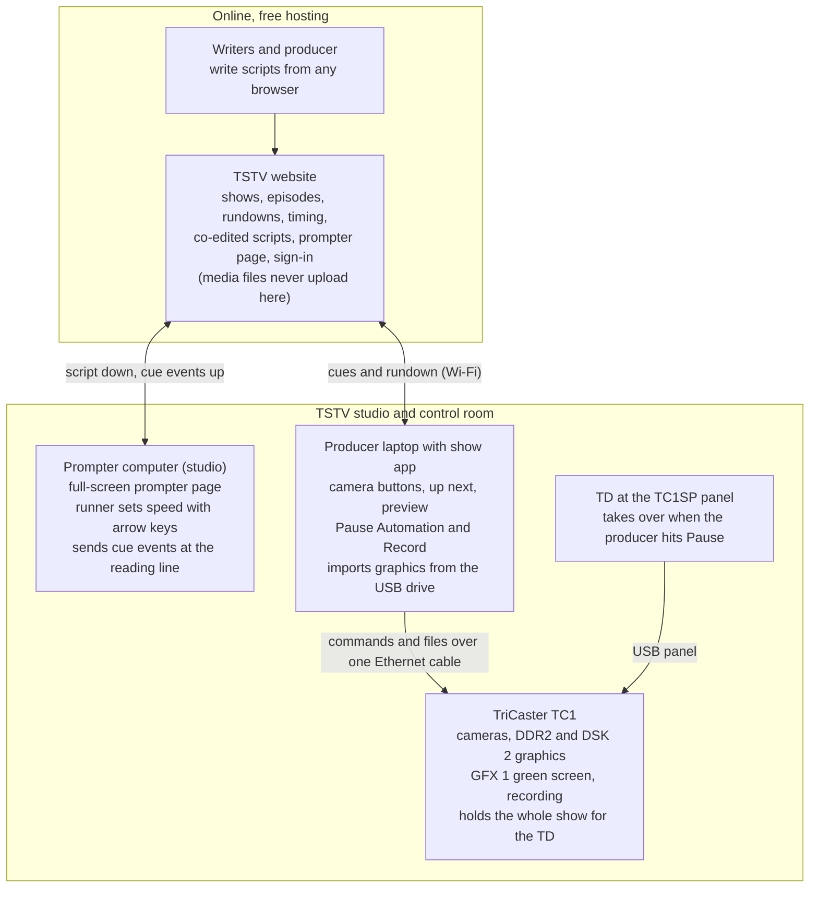

# TSTV Show Automation — Project Brief

Oct 28, 2026 · @RG Sureshkumar

TSTV will replace Rundown Creator with its own free rundown, script and prompter website, plus a laptop app that runs the TriCaster TC1 from prompter cues. One producer with no technical background can then run a live show from a laptop, with the TD on standby to take over on the physical panel only if the producer hits Pause Automation.

## Goals

The project is done when a producer can run a full 30-minute live show from her laptop without anyone touching the TriCaster.

- **One operator.** A producer with no technical background runs cameras, graphics, VOs, SOTs, packages, the green screen and recording from a laptop.
- **Cues fire themselves.** Each graphic or clip fires when its cue reaches the prompter's reading line.
- **Write from anywhere.** Writers type scripts from any location at any time. The producer edits live during the show, and the prompter updates without losing its place.
- **Rundown Creator retired.** Everything TSTV uses in Rundown Creator today exists in the new website.
- **Safe hand-off.** Pause Automation stops the tool following the prompter instantly. After that it sends only what the producer presses (manual mode, decided Oct 29, 2026). Every file and setting is already loaded on the TC1, so the TD takes over on the physical panel without hunting for anything.
- **$0 to run.** Free hosting only, no paid services, no paid code signing.
- **Mac and Windows.** Both the website and the laptop app work on either.

## The studio today

These are the facts the build has to fit, confirmed on site on Oct 28, 2026.

| Item | Today |
| --- | --- |
| Switcher | NewTek TriCaster TC1, software Version 7-7 (build 7-7-210722C), running on Windows 10 build 17763 |
| Control panel | TC1SP button panel. It connects over USB through a USB-over-Cat-cable extender (labeled "USB Extender"), not over the network. Leave it alone. |
| Network | Until now the TC1 was on no network: both Ethernet ports showed "Media disconnected" and `ping 8.8.8.8` returned "General failure." One port now has a cable for the show laptop. Label that port. Confirmed Oct 28: a laptop on that cable and the TC1 both give themselves automatic addresses and can talk with no settings changed (the TC1 was at 169.254.193.52). |
| Cameras | 3 studio cameras on TriCaster inputs 1, 2 and 3. Cameras 1 and 2 have prompter monitors and are used interchangeably for the anchors; camera 3 is the wide shot. All three face the green screen. Angles and zoom use other hardware and are out of scope. |
| Program path | Program runs through M/E 1: the main program row shows M/E 1, and cameras are switched on M/E 1's row. |
| Graphics and clips | L3s, OTS, FSGs, VOs, SOTs and packages all play from DDR2 and are put on air with the DSK 2 Take button. They're loaded from a USB drive in rundown order. DDR2 has AutoPlay on: taking DSK 2 on plays the cued clip, and taking it off stops DDR2 and cues the next clip. Each block in DDR2 starts with a break clip (today "TSTV Ident 2022 News") that's held during the commercial break. DDR1 is not used. |
| Green screen | Each show has its own green-screen background, which doesn't change during the show. The background lives in GFX 1, keyed with LiveMatte and layered in an M/E. The probe saw M/E 2 set up as a camera on its A row over GFX 1, and GFX 1 on program through M/E 1. |
| Audio | Separate sound board, out of scope. SOTs and packages carry their own audio from DDR2. The TC1's **Sound** player holds the show's music: the probe (Oct 28, 2026) found "PrimeTime Main" (`News_Under (1).wav`, 0:56) and "PrimeTime Transition Music" (0:21). |
| Streaming | YouTube, not through the TriCaster. Out of scope. |
| Recording | The TC1 records. Shows are often aired or published later. |
| Prompter | A dedicated Mac in the studio, using Safari. A prompter runner sets the speed with the arrow keys. Its screen feeds monitors on two cameras (cameras 1 and 2), and a physical mirror flips the image, so no software mirroring is needed. |
| Rundown | Rundown Creator, with no connection to the TriCaster |
| Show format | Many shows, each with its own rundown format. About 30 minutes each, blocks lettered A, B, C and on, usually 2 anchors plus a varying number of correspondents. Always live, often recorded. |
| Laptops | Most students' laptops have no Ethernet port. |

## How the pieces fit



Cues reach the laptop through the website because the prompter computer and the laptop can't reach each other on campus Wi-Fi. Pause and every TriCaster command travel only over the cable, so they still work if the internet drops.

## Part 1 — Rundown and script website

The website replaces the Rundown Creator features TSTV actually uses, and only those. Anyone signed in can use it from any browser on Mac or Windows.

**Shows and episodes**

- Anyone can **Add a Show** and name it anything. Each show holds **episodes**, and each episode has its own rundown, scripts, graphics and prompter text.
- **Shows page (decided Oct 29, 2026):** **Add a show** is at the top of the page, so it's easy to reach however many shows there are. Shows can be listed as a **list** or as **cards**, with a switch at the top; each browser remembers the choice.
- **Show logos (decided Oct 29, 2026):** each show can have a small logo, picked when the show is added or later in its settings, so shows are easy to tell apart. The browser shrinks it to 128 pixels at most before saving it on the website. A logo is part of the website, not show media: graphics and clips still never upload to the cloud. A show without a logo shows its initials.
- Every show uses the same interface. Shows differ only in their content: number of blocks, sections and talent.
- Each show has settings for its default camera (for example "Anchor Camera"), its usual talent, and its target length (default 30:00).
- **On-air talent per episode (decided Oct 28, 2026):** every episode has its own anchors and correspondents, so each episode has a section where the producer enters their names. Each person gets a color, used for their sections in the rundown and on the prompter.
- After air, an episode can be **archived** (read-only, still searchable) and **exported** as PDF and CSV.
- **Deleting episodes (decided Oct 29, 2026):** admins can delete any episode to save space, from the show's episode list or the episode itself. Its rundown and scripts are erased for good, after a warning.

**Rundown grid**

- One row per section, grouped under block headers A, B, C. Sections are numbered within the block: A1, A2, B1.
- Columns: Section, Slug, **Story Type** (renamed from Type on Oct 29, 2026: **Intro, Tease, Reader, Cross Talk, Q&A, Package, SOT, Permanent Graphic**, decided Oct 28, 2026, with Q&A and Permanent Graphic added Oct 29, 2026; each show can still edit its list), **Writer** (typed in; added Oct 28, 2026), Talent (picked from the episode's anchors and correspondents; **one or more people** per section, for a Q&A or any part where several people talk; or **Everyone (cross talk)** on its own, for real cross talk with no formal script, where the prompter just says CROSS TALK; decided Oct 29, 2026), Camera, **Headline** (typed in; added Oct 29, 2026), Elements (attached graphics with Ready or Missing status), **Notes** (typed in; added Oct 28, 2026), **Assign Graphics** (typed in: who makes the section's graphics; added Oct 29, 2026), Est. duration, Back-time. The column headers stay at the top while you scroll down the rundown. Each row's **⋯** menu sits right beside its number, like A1 ⋯ (decided Oct 29, 2026). *(No green-screen column: decided Oct 28, 2026, since each show uses one background for the whole show. See Part 3.)*
- **Decided Oct 28, 2026:** a section can have several things happening in it, so the **Elements** column (titled **Graphics** in the rundown) lists each section's elements in the order they fire. For example, a Reader can have an L3 and then a VO playing over the anchor.
  - Element types: L3, OTSL, OTSR, FSG, **TEASE**, **LITES**, VO, SOT and PKG (TEASE and LITES added Oct 29, 2026). Each element can also have an optional name.
  - In the rundown, graphics are blue and video is red. **LITES is a video** (decided Oct 29, 2026), so it's red like VO, SOT and PKG.
  - **MUSIC (decided Oct 29, 2026):** music is an element too, shown in purple and named by its track, such as the intro music that plays under the tease at the top of block A. The show app plays it from the TC1's Sound player when its cue is reached.
  - **Permanent graphics (decided Oct 29, 2026):** each show has a list of graphics used in every episode. TSTV's default list is Station ID, Show Intro, Commercial Break, Social Media L3, Website L3 and Station Outro, and each show can edit it in its settings. The Graphics column can pick any of them for a section. In Phase 4 the show app makes sure they're loaded on the TriCaster before every show.
  - Elements are planned in the rundown first.
  - In Phase 2 each element is linked to its cue chip in the script. In Phase 4 it's linked to its file in the show app, and the rundown shows ✓ when it has one.
  - The TriCaster cueing is built from them.
- **Commercial breaks (decided Oct 29, 2026):** a commercial break is added automatically between every two blocks. It shows the show's break permanent graphic (Commercial Break) and its length, and goes wherever the row below it goes. Each show sets its default break length in its settings (0:00 by default, which leaves breaks out of the timing); breaks count toward the episode total and back-times.
  - **Admins can change breaks in the rundown (decided Oct 29, 2026):** remove any break with the **×** to the left of "Commercial break", add a break above any section or block (from its ⋯ menu), and type a different length for one break right in its line, where it says "The show's break length". Clearing that length goes back to the show's. Contributors see the breaks but can't change them. (The website hides these controls from contributors; it doesn't block them on the server, which is fine for a team tool.)
- Drag rows to reorder, add or delete sections, and **float** a section (keep it but skip it on air). Section numbers update when rows move.
- **Publish rundown (decided Oct 28, 2026):** a new episode is a draft. Only the producer who created it and admins can see it. When the rundown is built, the producer clicks **Publish rundown** and everyone who can sign in sees it. The producer or an admin can unpublish it.

**Timing**

- Each section's estimated duration = script read time (word count at an adjustable words-per-minute rate) + the durations of its clips (SOT, PKG).
- Shows the episode total, over/under against the target length, and back-times (the clock time each block must start to finish on time).
- During the show, records each section's actual start and length from the prompter, so the producer sees how far over or under the show is running.

**Scripts**

- Each section has its own script. The prompter shows all sections in rundown order.
- **Script window (decided Oct 29, 2026):** clicking a slug opens its script in a small window over the rundown, not a full page. The rundown stays in view behind it. Close it with ×, Escape or a click outside it. The window's address can still be shared or bookmarked.
- **Several readers (decided Oct 29, 2026):** when more than one person talks in a section, the writer marks each person's part with their name in curly brackets on its own line above it, like `{JORDAN}`. *Proposed for Phase 3:* the prompter shows each `{NAME}` line as a speaker marker in that person's color.
- **Readers' names filled in (decided Oct 29, 2026):** a script with no words yet starts with each reader's `{NAME}` on its own line, from the section's Talent, and follows the Talent until someone writes in it. A written script with one reader and no name tag gets its reader's `{NAME}` at the top. Written scripts with several readers are left to the writer. Cross talk gets no names.
- **Capital letters (decided Oct 29, 2026):** scripts are written in capitals only, whatever the Caps Lock key says, including pasted text. Scripts written before then were switched to capitals once; the words didn't change.
- **Reading cue (decided Oct 29, 2026):** the script window, and in Phase 3 the prompter, clearly shows who reads each section (everyone, when several people share a section) and which camera to look at.
- **Decided Oct 28, 2026:**
  - Each slug in the rundown opens its script.
  - The script has a text box. Above it are a **word counter** and an estimate of how long a typical anchor takes to read the script, at **143 to 154 words a minute** (2.38 to 2.57 words a second).
  - It records everyone who edited the script, and who edited it last.
  - **The rundown's Est. fills in from the script's read time** (the middle of that range, 148.5 words a minute). Typing a length overrides it; clearing it goes back to the script's time.
- **Live co-editing**, like Google Docs: several people type in the same rundown and the same script at once, with each other's cursors visible and no overwritten work.
- **Cues** are inserted with a toolbar button or shortcut as locked chips in the text: Take L3, Take VO, Take SOT, Take PKG, Take OTSL, Take OTSR, Take FSG.
- **Decided Oct 29, 2026 (Phase 2):**
  - The cue toolbar lists the section's graphics from the rundown, and each chip is linked to its graphic, one cue per graphic. **Each cue chip is on a line of its own** (decided Oct 29, 2026): adding one in the middle of a line splits the line around it. **+ New graphic** adds a graphic to the rundown and drops its cue in one step. Renaming a graphic renames its chip; a removed graphic's chip shows as **Removed graphic**.
  - In the rundown, graphics with no cue chip in their script yet have a dashed outline.
  - **Camera cues (decided Oct 30, 2026):** the toolbar's **Cameras** row drops a **Take Camera 2** chip (amber), one button per show camera, on a line of its own like a cue chip. It switches cameras in the middle of a section. A section can have as many as it needs, and they move and delete like cue chips.
  - Speaker tags (`{NAME}`) show in the speaker's color, names that aren't the episode's talent are flagged, and a **Speakers** button starts each reader's part.
  - Speaker tags and cue chips don't count as read words.
  - Phase 1 plain-text scripts are copied into the editor word for word, one paragraph per line, and the original text is kept.
- Each section is tagged with the on-air **talent** who reads it, and the prompter shows that name at the section's start.
- During the show the producer can edit any script, and changes reach the prompter within about a second.

**Sign-in**

- Sign-in is required so outsiders can't edit scripts.
- **Invite emails (decided Oct 30, 2026):** inviting someone on **People** emails them the website's link and how to sign in, from a Google account through a free Google Apps Script (RG's Gmail for now, a TSTV Gmail later; no domain or card). Each pending invite has **Resend email**; if the email fails, the invite still works.
- **Decided Oct 28, 2026:** the website uses **Sign in with Google**, limited to people an admin invites. **Sign in with Microsoft** was added Oct 29, 2026, so people can use their school Microsoft 365 accounts (and personal Microsoft accounts); it's under the same invite rule. A school account signs in as its sign-in name (at UT, `abc123@eid.utexas.edu`) or, when that's who was invited, the school email in its account (`name@utexas.edu`). A school's IT may need to allow the app first. *Oct 30, 2026:* set up on RG's personal Microsoft account (with a free Azure directory); RG's personal account signs in. **UT accounts need UT's admin approval** ("Need admin approval"), which RG can request from the approval screen; until then UT people use Google. The app's client secret expires (about 24 months); when it does, make a new one in Certificates & secrets and run `npx wrangler secret put MICROSOFT_CLIENT_SECRET` again. The sign-in page says "Only people the Admin has invited can sign in."
- **Two kinds of account (decided Oct 29, 2026):** **Admin** and **Contributor**. Contributors build rundowns and write scripts. Admins also manage people (the **People** page), see the **Usage** page, delete episodes and change commercial breaks. The top right shows each person's name with "(Admin)" or "(Contributor)".
  - When inviting someone, ticking **Give Admin Access** makes them an admin; otherwise they're a contributor. On the People page, clicking a person shows **Give Admin Access** for a contributor (and **Remove Admin Access** for another admin). The emails in the `ADMIN_EMAILS` setting (the TD) are always admins.
- **Names (decided Oct 29, 2026):** the first time someone signs in, they type their first and last name, so everyone can tell who they are even when their Gmail account's name isn't their real one. The website uses that name from then on.
- **Top bar (decided Oct 29, 2026):** at the top left, a switch between **light and dark mode** for the whole website (each browser remembers it; until it's used, the website follows the computer's setting) and, for admins, an **ⓘ** icon for the Usage page. The menu reads **Shows, People, Search**; People is for admins only.
- **Authorship:** the site records who wrote and who edited each section's script and rundown row, so the producer knows exactly who wrote and edited each reader.

**Not in version 1:** team chat, per-person permissions, rundown templates, printing scripts.

## Part 2 — Prompter

The prompter is a full-screen page of the website, opened in a browser on the existing prompter computer. Its screen already feeds the camera monitors and mirror, so nothing else changes in the studio.

- **Controls:** the up arrow speeds up, the down arrow slows down, exactly like today. The spacebar pauses and resumes. Other keys jump to the next or previous section and back to the top.
  - **Decided Oct 29, 2026 (Phase 3):** a **prompter operator** runs it from the keyboard. Pressing the down arrow past a stop runs the text **backwards**, faster with each press, as today's prompter does. **Page Down** or **→** jumps to the next section, **Page Up** or **←** goes back to the start of the section (then the one before), **H** (or Home) goes back to the top, stopped. A **Go to section** list at the top, listing each section's number and slug, jumps to any section. **F** is full screen, **S** opens the settings and **?** the list of keys. The mouse wheel nudges the text.
  - **Signing in (decided Oct 29, 2026):** the prompter computer signs in to the website once with Google, ideally with a TSTV station Gmail that an admin invites, and stays signed in. (The show app connects with the episode's key instead of a sign-in; see Part 3.)
  - Opened from an episode's **Open prompter** button, at `/prompter/<episode>`.
  - **Looks (decided Oct 29, 2026):** the reading line is marked by big white arrows at each side. Each section starts with just its number, in green on a red box, and the camera to look at; who reads comes from the speaker markers in the script. A cross-talk section shows `**CROSS TALK**`, with the asterisks.
- **Settings:** text size, line width and margins, line spacing, text and background colors, the position of the reading-line marker, and **the size of the reading-line arrows** (added Oct 29, 2026). No mirror setting is needed.
- **What it shows:** each section starts with its number (B5) and the camera to look at (the talent names were dropped from this line on Oct 29, 2026; the speaker markers show who reads, and a cross-talk section just says CROSS TALK). Cues appear as bold colored markers in the text, as on today's prompter. Floated sections are skipped.
- **Live updates:** script edits appear as they're made without moving the text the anchor is reading.
- **Cue firing:** when a cue marker or section start crosses the reading line, the prompter sends that event to the show app (see Part 3). It also sends its position a few times a second so the producer can see where the anchors are. *(Phase 3: the rundown page shows where the prompter is and the last cue it fired. A jump with Page Down starts the section it lands on but doesn't fire the cues it skipped.)*
- **Internet drops:** the prompter keeps scrolling the last version of the script and shows a small warning to the runner. Edits sync again when the connection returns.

## Part 3 — Show app and TriCaster automation

The show app is a desktop app for Mac and Windows, installed once on each laptop that will run shows. At showtime it connects to the TC1 over the cable and to the website over Wi-Fi. Nothing is installed on the TC1.

**Name (decided Oct 30, 2026): the show app is called RiGster.** That's the name in its window title, at the top left of the app, and in its menus. Its NDI sources keep their names (**TSTV Show App** and **TSTV Show App Background**), so the TC1's input settings don't need changing. The app keeps what it remembers on the laptop in the same folder as before.

**Connecting**

- The producer plugs the USB-C-to-Ethernet adapter and the TC1 cable into her laptop and opens the app. The app finds the TC1 on the cable by itself. Producers never change network settings.
- **No sign-in in the show app (decided Oct 28, 2026).** Only one laptop is connected at a time, and running the TC1 means being in the studio on the cable.
- The app reads the rundown and cues from the website, using the episode key below.
- **Episode key (decided Oct 29, 2026):** every episode has its own key, which the producer (or an admin) copies from the episode's **Show app key** button and pastes into the show app. The key alone lets the app follow that episode and its cues, read-only; there's no separate laptop approval. **Make a new key** cuts off any app using the old one.
- Status lights show whether the website, the prompter and the TriCaster are connected.

**Producer screen**

- **Layout (decided Oct 29, 2026, from RG's sketch in `docs/show-app-sketch.pdf`):** across the top, the Program box (with the ● LIVE dot; on the simulator it shows the camera on air with the clip on DSK 2 playing over it, from small copies of the files the app makes on the laptop, decided Oct 29, 2026, for mock shows; the real TC1's program video comes later) with the camera buttons under it, the Playlist (on air and up next, with Import graphics), and Pause Automation with Section, Elapsed and Time left on the current graphic. Across the bottom, the Up next preview, the Permanent graphics drop box, the Green screen drop box and Music. The episode key and the status lights are at the top right. At the top left, a switch between **light and dark mode** (decided Oct 29, 2026; dark until someone flips it, and the laptop remembers the choice). Import graphics opens a window that shows which file is on which cue, with the files to place by hand.
- **Start live broadcast (decided Oct 29, 2026):** a button on the episode's page, for the producer who created it and admins, pressed when the show goes on air. The app's automation follows the prompter only while the show is live; before that it does only what the producer does by hand. The same button ends it (**End live broadcast**). It doesn't start recording.

- **Camera buttons:** each shows that camera's live picture (decided Oct 29, 2026; how the TC1 sends it is an open question below), one per camera, with names the producer sets (Anchor Camera, Weather Camera, Guest Camera). One click takes that camera to air. Input numbers are mapped once in settings. Under them, **Switch cameras by hand** (decided Oct 29, 2026) takes the cameras off the prompter: sections starting no longer switch cameras, the producer clicks them, and the graphics still follow the prompter. **Give cameras back to the prompter** undoes it, and the next section that starts takes its camera.
- **On air / Up next:** what's on air now, and the queue of upcoming cues. While the clip on air plays, a see-through bar fills across it, with the time left at its end (decided Oct 29, 2026). The producer can skip an element, pick a different one to play next, or fire the next cue by hand, all without touching the TriCaster.
- **Preview:** what the next element will look like on air: the camera it plays over (its live picture), with the graphic laid on top, keeping the graphic's see-through parts (decided Oct 29, 2026). Until the TC1's camera video reaches the app (Phase 5), the simulator's test pictures stand in. A live video preview from the TriCaster is a possible later upgrade.
- **Sound strip (decided Oct 29, 2026):** down the right edge, one level meter and one fader (silent to +6 dB) for all of Program's sound, the clip on DSK 2 and the music together (RG: just one, Oct 29, 2026). On the simulator it sets the sound the app plays; on the real TC1 it should set DDR 2's and the Sound player's audio levels together, commands to confirm in Phase 5.
- **Pause Automation:** a large button plus a keyboard shortcut (see below). In manual mode it becomes **Continue Automation**.
- **Record:** starts and stops the TC1 recording, after the producer picks where the file should be saved.
- **Show clock:** elapsed time, the current section, and over/under.

**Importing graphics**

- On an episode, the producer clicks **Import graphics** and picks the files or folder, usually from the USB drive the graphics team hands her.
- File names follow `[Block][Section]_[Type]_[Slug]`, for example `B5_VO_Basketball.mov`. Types: L3, OTSL, OTSR, FSG, TEASE, LITES, VO, SOT, PKG, plus the real playlist's **NAMES** (a lower third with the anchors' and correspondents' names, treated as L3) and **RDR** (an OTS graphic) (RG, Oct 29, 2026). Spellings like `OTS_L`, double underscores, `(1)` or `copy` at the end, and spaces are read too.
- **Matching (decided Oct 29, 2026):** by section number and type first, then a check that the file's slug looks like the section's; if it doesn't, the app asks.
- **Permanent graphics** are given a file once per show, and the app remembers it for every episode.
- The app reads each name and attaches the file to the matching cue in that section. `B5_VO_Basketball` goes to section B5's Take VO cue. It also reads each file's length and makes a thumbnail.
- It stops and asks the producer whenever it can't decide. For example: two files of the same type for one section (`B5_VO_Basketball1`, `B5_VO_Basketball2`), more files than cues, a cue with no file, a section that doesn't exist, or a name that doesn't follow the pattern. The producer drags each file onto the right cue.
- Formats: L3, OTS and FSG files are Apple ProRes 4444 with alpha in QuickTime (.mov). VO, SOT and PKG files are .mov or .mp4.
- **The media files never go to the cloud.** ProRes 4444 is far too large for free storage. Only file names, lengths and thumbnails sync to the website. The files stay on the laptop until they're sent to the TC1.

**Graphics reach the TC1 over NDI from the laptop (decided Oct 30, 2026, Phase 5)**

- RG plugs the graphics drive into the laptop and imports as today. **No files are copied to the TC1**, so the TC1 needs no Windows login and its owner doesn't need to sign off.
- The show app plays each graphic itself and sends it to the TC1 over the cable as a live **NDI** source (with its see-through parts and sound). On the TC1, that source is set once as **DSK 2's source** in the TSTV session, in place of DDR 2; the app puts DSK 2 on and off as before.
- The same NDI link brings the cameras' pictures into the app (in Phase 5, RG, Oct 30, 2026), and the app records the TC1's program feed onto the laptop, so recordings don't have to be copied off the TC1 (RG wants the recording on the laptop).
- **Proven at the studio Oct 30, 2026** (details in `docs/TC1-FINDINGS.md`): the TC1 shows the laptop's NDI source on an input, keys it over a camera with its see-through parts, and gets its sound; and the TC1's camera and program feeds play live on the laptop at 60 frames a second. Fallback: the TD loads DDR 2 from USB, and the app cues DDR 2 as in Phase 4.
- The app sends NDI only on the cable to the TC1, never on campus Wi-Fi.
- **How the TC1 is set up for it (RG, Oct 30, 2026):** in the TSTV session, **input 4** is the laptop's NDI source ("TSTV Show App") and **DSK 2's source is input 4** (instead of media player B), saved once. Input 4's sound is set always on (not following video) in the TC1's audio mixer, once.
- **Music comes from the laptop too (RG, Oct 30, 2026):** the track dropped on the Music box plays from the laptop and goes to the TC1 with the graphics' sound over NDI, through the one Sound fader. The TC1's Sound player isn't used.
- **In live mode the Program box shows the TC1's real program** (its MIX 1 feed), picture only so the laptop doesn't echo sound into the studio; the camera boxes show the TC1's camera feeds (1)–(3).
- **The green-screen background comes from the laptop too (RG, Oct 30, 2026):** the image or clip dropped on the Green screen box goes to the TC1 as a second NDI source, **TSTV Show App Background** (a still sent steadily, a clip on a loop, filling the picture). On the TC1, a spare input (like input 5) is set to it and used as M/E 1's background behind the keyed cameras, in place of media player A or GFX 1.
- **Record saves on the laptop only (RG, Oct 30, 2026):** the TC1's program feed, picture and sound, to a folder the producer picks, named `Show_Episode_Date`. The TC1's own recording stays as the TD sets it.

**Send to TriCaster (before the show, at the station)** *(superseded Oct 30, 2026 by graphics over NDI above; kept for the USB fallback)*

- One button copies the episode's files to the TC1, builds the DDR2 playlist in rundown order with each item named by section, and loads any green-screen backgrounds.
- The app then checks that the TC1 has everything and marks each element Ready or Missing. This also sets up the TD's fallback: the TC1 already holds the full show in order.
- The app also produces a one-page **TD fallback sheet** listing each section's camera, elements and DDR2 position.
- If the TC1 can't receive files over the cable, the TD loads DDR2 from the USB drive as today, and the app matches the playlist by file name.

**Cameras by section**

- Each section can name a camera in the rundown. For example, B2 is set to Weather Camera.
- When a section starts, the app takes its camera. When it ends, the app goes back to the show's default camera (Anchor Camera), unless the next section names a different one.
- **Camera cues (decided Oct 30, 2026):** a camera cue in the script takes its camera when it reaches the prompter's reading line, in the middle of the section. The prompter shows it as an amber **TAKE CAMERA 2** marker. One at the very top of the script, above any words, takes its camera as the section starts, instead of the section's camera. Like a section's camera, it does nothing in manual mode or with the cameras by hand.
- The producer's camera buttons override this at any time.

**Green screen**

- **Decided Oct 28, 2026:** each show uses one green-screen background for the whole show. There is no green screen per section.
- **The show app has a single green-screen drop box.** The producer drops the image or clip for the show's background onto it, and the app loads it on the TC1 as the background used throughout the show.
- The TD sets up the green-screen M/E's LiveMatte key once and saves it in the TC1 session. After that nobody keys anything by hand.
- Stills go in GFX 1. A clip background needs a free player; DDR1 is free (confirmed Oct 28).

**Recording**

- Record asks where to save, then starts the TC1 recording. Files are named `Show_Episode_Date`.
- If the TC1 can only record to its own drives, the app copies the file to the chosen location over the cable after the show.

**Pause Automation and failures**

- **Pause** switches the app to **manual mode** at once (decided Oct 29, 2026; until then Pause stopped every command). The prompter keeps scrolling, but its cues fire nothing and take no cameras, so the app sends nothing on its own. The producer runs the graphics from the keyboard: **Space** or **→** fires the next graphic, **←** puts the previous one up again, and **↓** takes the graphic off. Cameras change only when the producer clicks one. A SOT, package or VO the producer fires still comes off when its clip ends. The TD can still take over on the physical panel. Pause goes over the cable, so it works even if the internet is down.
- **Continue Automation** (the same button, or the same key) hands the show back to the prompter: the app picks up from the prompter's current position and fires the graphics as its cues reach the reading line. It doesn't fire the cues passed in manual mode.
- **Lost prompter link:** if prompter events stop arriving, the app shows a banner. The producer can keep the show going by firing the next cue with the spacebar.
- **Simulator mode:** the app can run against a fake TriCaster for practice and testing. It talks to the real TC1 only when someone switches to live mode on purpose.

## Cue rules

Every element except MUSIC plays from DDR2 through DSK 2. Only one element is on DSK 2 at a time, so a new cue replaces whatever is up. **A clip that replaces another cuts straight to it** (decided Oct 29, 2026): DSK 2 stays on while DDR2 selects the new clip and plays it, so the camera never flashes between two clips, like back-to-back teases. Only a clip going up over the camera takes DSK 2 on (which plays it, with AutoPlay). To confirm on the TC1 in Phase 5. When a section starts, its first element is cued in DDR2 so it's ready to fire.

| Element | Goes up | Comes off |
| --- | --- | --- |
| L3 | Its Take L3 cue reaches the reading line (usually the top of the section) | The section ends. It comes back up if a VO in the same section ends early. |
| OTSL / OTSR | Its cue reaches the reading line | The section ends |
| FSG | Its cue reaches the reading line | The section ends |
| VO, TEASE, LITES | Its cue reaches the reading line, and DDR2 plays the clip while the anchor reads (TEASE and LITES play like a VO: RG, Oct 29, 2026) | **Clip ends first:** DSK 2 off, the anchors are back, and the section's L3 returns if it has one. **Section ends first:** DDR2 stops, DSK 2 off, back to the anchors. |
| SOT | Its cue reaches the reading line, and it plays with its own audio | The clip ends, then back to the anchors (confirmed by RG, Oct 29, 2026) |
| PKG | Same as SOT | Same as SOT (confirmed Oct 29, 2026) |
| Permanent graphics | Their cue. Those with their own audio (Show Intro, Station ID, Station Outro, Commercial Break) play like a SOT; Social Media L3 and Website L3 are lower thirds (RG, Oct 29, 2026). Each show sets which are which in its settings. | Like a SOT, or like an L3 |
| Commercial break | **Decided Oct 29, 2026:** the break's line reaches the prompter's reading line, and the show's break graphic (Commercial Break) plays from DDR2. It's the last cue of the section before the break, so it's up next after that section's cues. | **The next section starts** (RG, Oct 29, 2026): it stays up for the whole break, holding after its clip ends, and comes off onto the next section's camera. |
| Camera cue | Its chip reaches the reading line (or the section starts, for one at the very top of the script): the switcher takes its camera (RG, Oct 30, 2026) | The next camera cue, or the next section's camera |
| MUSIC | **By default whenever a TEASE graphic fires** (decided Oct 30, 2026; until then, when the first Tease section in block A started, which the producer can still pick as the single music-in point instead); also when a MUSIC cue reaches the reading line. The Sound player plays the show's track alongside DDR2, so graphics can go up over it. **The track is the one the producer drops on the show app's Music box** (decided Oct 29, 2026); without one, the Sound player track named like the MUSIC element. | By default just before the Show Intro fires. Music a tease started later in the show (after the music-out point) stops when the teases end: it plays on through back-to-back teases and stops when the last one comes off (RG, Oct 30, 2026). The producer can change the music-in and music-out points for each show in the show app. |

A section "ends" when the next section's start crosses the prompter's reading line. **A cue at the very top of a section's script, above any words to read, fires as the section starts** (decided Oct 29, 2026), not once the section's number, camera and talent lines have scrolled past, so back-to-back teases play one after another without the camera between them. Clip end comes from the TriCaster's own playback status when it's available. Otherwise it comes from the clip length measured at import.

## Technical decisions

These are settled. Claude Code should check current free-tier limits before committing to a specific service.

- **Free hosting only.** The website and its database must run on free tiers with no credit card. **Decided Oct 28, 2026: Cloudflare's free tier** (Workers for the website and sign-in, a D1 database, and one Durable Object per episode for Yjs co-editing and the cue relay), chosen over Supabase because Cloudflare doesn't pause free projects over breaks. It starts on RG's personal Cloudflare account and can move to a TSTV-owned account later. See `docs/ARCHITECTURE.md`.
- **Mac and Windows.** The website runs in any modern browser. The show app is one cross-platform desktop app (Electron is the likely choice) with installers for both.
- **No code-signing fees.** That means Mac and Windows warn on first install. Include the one-time "Open anyway" steps in the user guide.
- **Nothing installed on the TC1.** The station may not allow it. Changing a TC1 setting, such as a fixed network address or a shared folder, needs approval from whoever is responsible for the equipment.
- **Why a laptop app and not just a webpage.** Browsers block secure websites from sending commands to devices on a local cable. They also can't keep the open connection that reports clip status, or copy files onto the TC1. The app handles those parts.
- **Network.** One Ethernet cable from the TC1's open port, plus a USB-C-to-Ethernet adapter kept at the desk, connects any laptop. Wi-Fi stays on for the website. Use no wall jacks and no routers: UT policy forbids extending the campus network with your own wireless equipment.
- **Cue path.** Cues travel prompter computer → website → show app → TC1, because the prompter computer and the laptop can't talk directly on campus Wi-Fi. Target: under half a second from the reading line to the TriCaster. Measure this and show it in the app.
- **Media stays local.** Graphics and clips go from the laptop straight to the TC1 and never upload to the cloud.
- **Simulator first.** A fake TriCaster lets everything be built and practiced without the TC1, because time on the real switcher is limited. Real commands go out only in a clearly marked live mode.

## Verify on the TC1 first

The automation depends on what the TC1 accepts from another computer, and that isn't confirmed yet. Claude Code's first job is a probe tool that the TD runs in one session at the station and that saves everything it learns to a file. Version 7 TriCasters support macros and network control panels (LivePanel), and third-party controllers such as Bitfocus Companion talk to them over the network. The exact commands still have to be confirmed on this unit.

| Question | Why it matters | Fallback if the answer is no |
| --- | --- | --- |
| Can a laptop on the cable reach the TC1, and at what address? | Everything else depends on it | Adjust the TC1's network setting (needs approval) |
| Which remote-control interface does the TC1 accept, and what commands does it list? | Camera takes, DSK 2, DDR2 control | Have the TD build TriCaster macros once and trigger those |
| Can DDR2 jump to a specific playlist item, play, stop, and report when a clip ends? | VO rules, skipping, bringing the L3 back | Use the clip lengths measured at import as timers |
| Can files be copied onto the TC1 and loaded into DDR2 and GFX 1 remotely? | Send to TriCaster, green-screen drop | TD loads from USB; the app matches by file name |
| Can recording start and stop remotely, and can its save location be set? | Record button | Copy the file over the cable after the show |
| Can the app read what's on program, DSK 2 and the M/Es? | Showing the producer what's really on air | The app tracks state itself |
| With DSK 2 on, does selecting another DDR2 clip and playing it (`ddr2_select_clips`, `ddr2_play`) cut straight to it? | Clip-to-clip cuts with no camera between them (Oct 29, 2026) | DSK 2 off, cue, DSK 2 on, as the TD does today (a few frames of camera) |

**Probe results, Oct 28, 2026** (details in `docs/TC1-FINDINGS.md`):

1. **Reach:** yes, with no settings changed.
2. **Interface:** yes. The web control on port 80 needs no password, and the port-5951 state stream and change notifications both work.
3. **DDR2:** partly confirmed. It reports the selected item, play and stop, the playlist, and seconds remaining. Jumping and playing get confirmed in live mode in Phase 5.
4. **Files:** file sharing is on but needs a Windows login on the TC1, which needs the owner's approval. Otherwise the fallback applies.
5. **Recording:** on and off is reported. The save location isn't exposed, so the TD sets it once.
6. **What's on air:** yes.

## Build plan

There's no deadline, so the plan aims for the fastest path to a first live test. Each phase ends with a short test RG can run, and the next phase waits for his OK. Phases 1–3 replace Rundown Creator on their own, even before any automation works.

0. **TriCaster probe and simulator.** The probe tool from the section above, plus a fake TriCaster that behaves like the TC1. Test: RG runs the probe at the station; Claude Code reads the results file. *Done Oct 28, 2026.*
1. **Website foundation.** Sign-in, Shows and Episodes, the rundown grid, timing, archive and export. Test: build a real episode's rundown. *Approved Oct 29, 2026.*
2. **Script editor.** Section script pages with live co-editing, cue chips and talent tags. Test: two people edit the same script at once. *Approved Oct 29, 2026.*
3. **Prompter.** Full-screen prompter with arrow-key control and live updates. Test: run a past show's script on the prompter computer. *Approved Oct 29, 2026.*
4. **Show app on the simulator.** Producer screen, graphics import and matching, the cue engine with every rule above, cameras by section, Pause and manual cues. Test: a full mock show against the simulator. *Approved Oct 30, 2026* (with back-to-back teases left to revisit; see Open questions).
5. **Real TC1.** Send to TriCaster, live cues, the green screen and recording on the switcher. Test: a rehearsal on the TC1 outside a show. *Full run-through on the TC1 went smoothly, Oct 30, 2026 (graphics, green screen and music over NDI from the laptop).*
6. **Ship it.** Mac and Windows installers, a one-page producer guide, a pre-show checklist and the TD fallback sheet. Test: someone who has never used it runs a rehearsal from the guide alone.

## Open questions

- [ ] **Back-to-back teases (to come back to; RG, Oct 29, 2026):** the change from one tease to the next still isn't right in the mock show, after the top-of-section cues and the clip-to-clip cut (see Cue rules). Revisit with RG, and on the TC1 in Phase 5.

- [ ] **How do the cameras' pictures reach the show app?** RG wants each camera's video playing in its button (Oct 29, 2026). The TC1 sends video over the network with NDI on 4 mix outputs, and its NDI ports (5960, 5961) were open on Oct 28, but one output already goes to TSTV's YouTube stream. *Oct 29, 2026, at the studio:* the TC1 sends 8 NDI feeds over the cable, `(1)` to `(4)` and `(MIX 1)` to `(MIX 4)`; all four mix outputs show Program. In NDI Video Monitor, the numbered feeds showed one still frame, then black. To settle in Phase 5: which feed is which camera, whether the feeds play live on the laptop (NDI's transport and the TC1's firewall), and whether to set spare mix outputs to cameras. Details in `docs/TC1-FINDINGS.md`. Showing cameras this way may mean setting spare mix outputs to cameras 1–3 (a TC1 setting, which needs the owner's OK) and installing NDI's free software on the laptop. Until then, the simulator gives each camera a moving test picture, and the three look nothing alike (Camera 1 blue, Camera 2 green, Camera 3 orange; Oct 29, 2026).
- [x] Do SOTs and packages play to the end and then go back to the anchors, as assumed? *Yes (RG, Oct 29, 2026).*
- [x] Which TriCaster inputs are the three cameras, and which camera faces the green screen? *Inputs 1–3. Cameras 1 and 2 have prompter monitors; camera 3 is the wide shot. All three face the green screen.*
- [x] Is DDR1 free for green-screen video backgrounds? *Yes. It isn't used.*
- [ ] Who must approve changing TC1 settings (a fixed network address, a shared folder)? *No network change is needed. Copying files over the cable needs a Windows login on the TC1.*
- [ ] During a show, is the green-screen key on air the whole time behind the anchors, and through which M/E? The probe saw GFX 1 on program through M/E 1. *(There's no per-section green screen: decided Oct 28, 2026.)*
- [x] How do the file types TEASE, NAMES, RDR and LITES (seen on the real DDR2 playlist) map to cues? Should the importer also accept spellings like `OTS_L` and names ending in `(1)` or `copy`? *TEASE and LITES play like a VO; NAMES is an L3; RDR is an OTS; and yes to the spellings (RG, Oct 29, 2026).*
- [x] Intro music: when does it start and stop? *By default it starts with the first Tease in block A and stops just before the Show Intro; each show can change both in the show app (RG, Oct 29, 2026). The track is the MUSIC element's name, like "PrimeTime Main". Whether the sound board needs to do anything is still to confirm.*
- [ ] When the app builds the DDR2 playlist, should it put the break clip ("TSTV Ident 2022 News") at the start of each block, as TDs do today?
- [ ] Who may sign in to the website: invited people only, or anyone with a UT email?
- [ ] Should old Rundown Creator rundowns be imported, or does TSTV start fresh?
- [ ] Which TC1 network port has the new cable? Label it "Show laptop." *The cable works. The label still needs to go on.*

## Starter prompt for Claude Code

This file is `PROJECT_BRIEF.md`. Open Claude Code in the folder that holds it and paste the prompt below. The repo URL is already filled in.

```plain
You're building TSTV Show Automation for Texas Student Television. The full spec is in PROJECT_BRIEF.md in this folder. Read all of it before doing anything. It is the source of truth: if something in it is unclear or seems wrong, ask me instead of guessing.

About me: I'm RG, TSTV's technical director. I'm not a professional developer, so explain decisions in plain language and give me step-by-step test instructions I can follow.

Setup first:
1. I created the GitHub repo myself. Its URL is: https://github.com/rg-sureshkumar-goat/TSTV-TriCaster-Automation. Connect this folder to that repo, set up the project structure, and commit PROJECT_BRIEF.md as docs/PROJECT_BRIEF.md. Push to GitHub as you go. Never create GitHub repos yourself: if you need another one, ask me and I'll make it and give you the URL.
2. Write docs/ARCHITECTURE.md: the stack you recommend for the website, the prompter and the show app, and how the parts talk to each other. Check the current free-tier limits of every hosted service you pick. Everything must run at $0 with no credit card. Wait for my OK before building.

Then follow the Build plan in the brief, starting with Phase 0:
- Build the TriCaster probe: one command I run on a laptop connected to the TC1 by cable. It finds the TC1, discovers which remote-control interface it accepts and which commands and states it exposes, and saves everything to a results file I can send you. It must only read and never change anything on the switcher. Study bitfocus/node-tricaster on GitHub to see how other tools talk to TriCasters.
- Build the TriCaster simulator so every later phase can be developed and tested without the real switcher.

Rules for the whole project:
- Stop at the end of each phase. Summarize what you built, tell me exactly how to test it, and wait for my OK before starting the next phase.
- Never send a command to the real TC1 unless the app is in a clearly marked live mode that I turn on myself. Simulator mode is the default.
- Install nothing on the TC1. Media files never upload to the cloud.
- Everything must work on both Mac and Windows.
- When we change a decision, update docs/PROJECT_BRIEF.md in the same commit.
```

## Sources

- [NewTek TriCaster TC1 Version 7 new features (Videoguys)](https://videoguys.com/blogs/news-and-sales/newtek-tricaster-tc1-version-7-new-features)
- [TriCaster TC1SP panel specs: USB connectivity (Markertek)](https://www.markertek.com/product/tri-tc1sp/vizrt-tricaster-tc1sp-14-button-control-panel-for-tricaster-tc1)
- [Vizrt docs: control surface connections](https://docs.vizrt.com/viz-now-launchpad/1.4/Control_Surfaces_for_TriCaster_Now.html)
- [TriCaster user guide, Elite and Pro models: macros, LivePanel, media network sharing (UiO mirror)](https://www.uio.no/tjenester/it/lyd-video/db/driftsdokumentasjon/produktmanualer/tricaster.pdf)
- [@bitfocusas/tricaster, a Node library for network control of TriCasters](https://www.skypack.dev/view/@bitfocusas/tricaster)
- [Rundown Creator TriCaster Playout Controller](https://www1.rundowncreator.com/how-it-works/tricaster-playout-controller)
- [Rundown Creator teleprompter](https://www1.rundowncreator.com/how-it-works/teleprompter)
- [Rundown Creator API](https://www1.rundowncreator.com/api/getrundowns)
- [Rundown Studio vs. Rundown Creator (feature and pricing overview)](https://rundownstudio.app/blog/rundown-studio-vs-rundown-creator)
- [UT Austin: Management of UTnet Wireless Access policy](https://tech.utexas.edu/sites/default/files/documents/management-of-utnet-wireless-access-policy.pdf)
- [UT Austin wiki: connecting a device to utexas-iot](https://cloud.wikis.utexas.edu/wiki/spaces/TAR/pages/36864142/Connecting+a+Jetson+to+utexas-iot)
